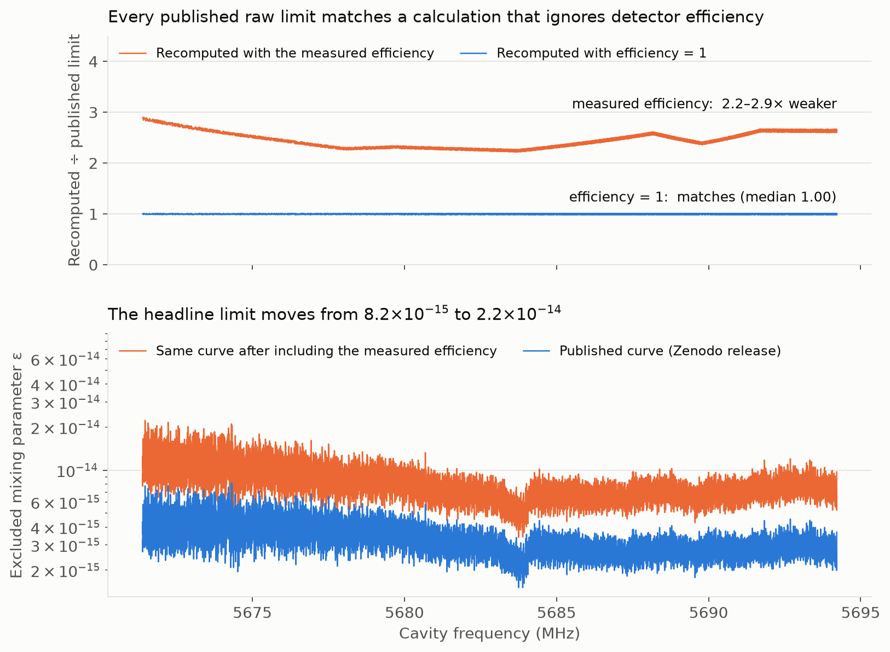

# SQuAD hidden-photon limits: detector efficiency left out

**[Zhao, Li et al. (2025), PRL 135, 201002](https://doi.org/10.1103/clp9-xc2n) report that their tunable photon counter constrains the hidden-photon kinetic mixing to ε < 8.2×10⁻¹⁵ between 5.672 and 5.694 GHz. The released limits match a calculation that assumes the detector registers every signal photon. The paper's own calibration shows it registers only 14–20%.**

**Including the measured efficiency weakens every limit by 2.2–2.9×. The headline bound becomes ε < 2.2×10⁻¹⁴.**

This repository contains the released data, the recomputation code and the saved results.

## The efficiency is measured, then not applied

Section III of the paper calibrates the detector efficiency η by injecting known photon populations. It reports that η "remains reliably above 14%". The authors' released analysis notebook tabulates η at 11 flux points (6.81–19.81%). Its own limit model multiplies the expected signal by η:

```text
expected counts = background + η × N_HP(ε),     N_HP ∝ ε²
```

The signal scales as η·ε². So a limit computed with η = 1 is too strong in ε by a factor of 1/√η.

## The published limits match η = 1

We recomputed all 12,694 released limits from the released photon counts. We used the notebook's signal model and constants, the paper's background filter (Savitzky–Golay, order 4, window 112), and the CLs 95% test of its reference method.

| Calculation | Recomputed ÷ published limit, all 12,694 tunings |
|---|---:|
| Efficiency η = 1 | **0.986 – 1.010** (median 0.998) |
| Measured η, 10-point table (without the 6.81% point) | **2.22 – 2.90** (median 2.46) |
| Measured η, 11-point table (with the 6.81% point) | **2.22 – 3.86** (median 2.58) |

The small η = 1 residuals show no trace of the efficiency curve (rank correlation with 1/η: 0.007). Two other background estimates give the same result (medians 1.004 and 0.999).

## The headline number changes

The published limit curve (`hidden_photon_result_smoothed.npy`) is built from these raw limits by the release's own minimum-envelope rule. Our replay of that rule reproduces all 126,940 published points to within 8×10⁻¹⁶. Repeating the same step with each raw limit divided by √η gives:

| | Published | With measured efficiency |
|---|---:|---:|
| Weakest limit in the band (the abstract's number) | ε < **8.2×10⁻¹⁵** | ε < **2.2×10⁻¹⁴** |
| Change at each frequency | — | 2.25 – 2.88× weaker (10-point table) |



## Limits of the finding

- **The program that wrote the published limits is not in the release.** The notebook's limit cell is an earlier version: it uses a 90% binomial test and marginalizes over η. An undocumented step could compensate for η elsewhere. To do so, it would have to vary with frequency exactly as 1/√η does.
- **The paper says it marginalizes over measured parameters.** The published array matches the nominal η = 1 calculation without marginalization to about 1%. Marginalizing over uncertainties would weaken the limits further, not restore them.
- **We test consistency, not the calibration itself.** The efficiency values, cavity model and geometric factors are the authors'. We do not assess how the corrected limit compares with other experiments at these frequencies.

## Reproduce the checks

Read the efficiency table and the signal model from the released notebook (Python standard library only):

```bash
python3 scripts/check_efficiency.py
```

Verify the files and saved results, then rerun the full recomputation (Python 3.12, about 30 seconds):

```bash
python3 -m venv .venv
.venv/bin/python -m pip install -r requirements.txt
.venv/bin/python scripts/verify.py
.venv/bin/python scripts/reproduce.py
```

[Methods and limitations](docs/METHODS_AND_LIMITATIONS.md) · [Evidence guide](docs/EVIDENCE.md) · [Saved results](results/) · [File checksums](SHA256SUMS) · [Data provenance](provenance/SOURCES.json) · [Attribution and licensing](THIRD_PARTY_NOTICES.md)

Independent, AI-assisted audit dated 3 November 2026, examining [arXiv:2501.06882v2](https://arxiv.org/abs/2501.06882v2) and the [Zenodo 17210375](https://doi.org/10.5281/zenodo.17210375) data release. This is not an author-issued correction.
